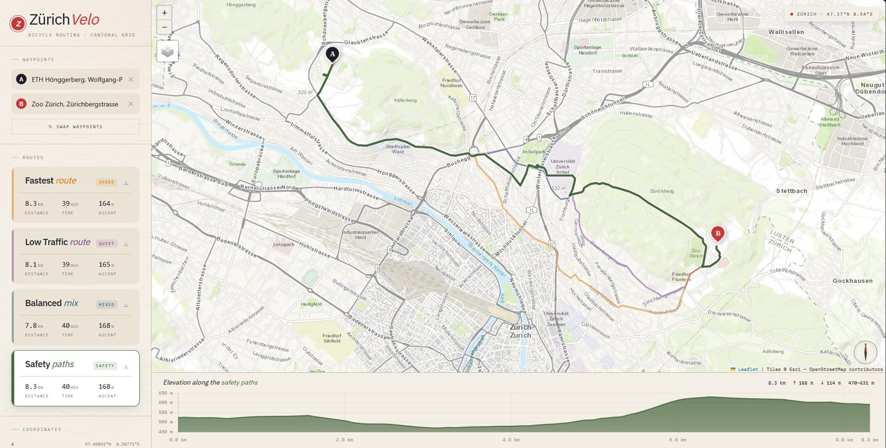

# ZürichVelo

A bicycle route planner for Switzerland. Set a start, a destination and any number of stops, and
compare up to eight cycling strategies side-by-side. Each one shows distance, your-pace time, power,
e-bike battery use, traffic exposure and an interactive elevation profile. Then press **Start ride**
for a GPS live mode with off-route rerouting and "find the next fountain" shortcuts.



## Features

**Planning**
- **Multi-stop routes**: add, reorder, reverse and remove stops. Click the map, search, drag pins, or add a place along the route.
- **Routing profiles** via BRouter: Fastest, Low Traffic, Balanced, Car-free and Safety by default. Shortest, Gravel and MTB are optional (⚙ Profiles).
- **Your pace, watts & battery**: a physics model (gradient, weight, bike type, air and rolling resistance) gives times at your effort, Ø km/h, average watts and kcal. For e-bikes it adds battery % with a warning when the battery won't last the route.
- **Traffic exposure**: each route card shows how much of the route is separated or calm, on a bike lane or quiet road, or in mixed traffic. You can also colour the route on the map by safety or surface.
- **Places along the route**: drinking fountains 💧, repair 🔧, e-bike charging 🔌, cafés, groceries, toilets, gas stations, hotels, train stations and viewpoints, all within 150 m of the route (OpenStreetMap via Overpass). Any of them can become a stop in one click.
- **Bike networks**: SchweizMobil / Veloland national, regional and local routes, MTB routes and Waymarked Trails overlays. Basemaps include swisstopo, CyclOSM and aerial imagery.
- **Shareable links**: the URL holds the stops, the chosen profile and the basemap.
- **GPX export** with named waypoints.

**Live mode**
- Shows your position with accuracy and heading, and the map follows you.
- Shows speed, distance to go, arrival time and climb remaining.
- Warns about the next climb ("Climb in 300 m: 1.2 km at 7 %").
- Shows the next fountain or repair stop ahead, with one-tap "add as stop".
- Detects when you're off route and reroutes automatically.
- Keeps the screen on.
- Records the ride and saves it as a GPX file with timestamps. Location never leaves your device, except as the start point of a reroute request.

**Mobile**
- The bottom sheet can be swiped up to expand or down to dismiss. Resize handles work with touch and pen.

## Getting started

```bash
pnpm install
pnpm dev       # http://localhost:5173
```

The app opens with a pre-loaded route (Zürich Bahnhofplatz → Affoltern am Albis).
Geolocation (locate button and live mode) needs HTTPS or `localhost`.

## Configuration

All configuration is optional. Copy `.env.example` to `.env.local`:

```bash
VITE_THUNDERFOREST_KEY=   # thunderforest.com — OpenCycleMap basemap
VITE_MAPTILER_KEY=        # maptiler.com — outdoor basemap
VITE_BROUTER_URL=         # self-hosted BRouter instead of brouter.de
```

Without keys the app uses free providers (swisstopo, CyclOSM, ESRI, OSM, CARTO) with automatic failover.

## Scripts

```bash
pnpm dev        # development server with HMR
pnpm test       # unit tests (Vitest)
pnpm lint       # ESLint
pnpm build      # type-check + production build
pnpm preview    # serve the production build locally
```

CI (`.github/workflows/ci.yml`) runs lint, test and build on every PR.

## Stack

- React 19 + Vite 6 + TypeScript 5 (strict)
- Tailwind CSS v4 with `@theme` design tokens
- Leaflet 1.9 (vanilla, imperative) for the map
- Chart.js 4 (vanilla canvas) for elevation profiles
- **BRouter** for routing, **Photon** for search, **Nominatim** for reverse geocoding (throttled to 1 req/s), **Overpass** for places
- swisstopo WMTS (geo.admin.ch) for Swiss basemaps and SchweizMobil overlays

See [`ROADMAP.md`](ROADMAP.md) for what's done, what's next, and the idea backlog.
Contributor and architecture notes are in [`CLAUDE.md`](CLAUDE.md).
